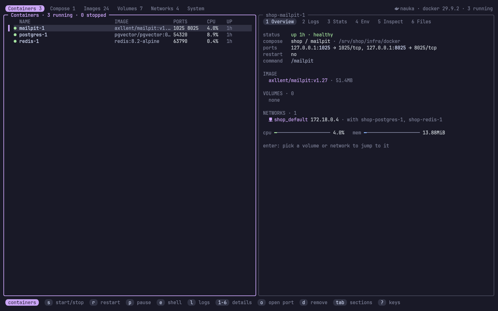
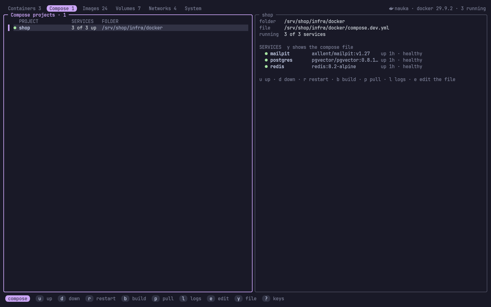

# nauka

<!-- identity -->
<p align="center">
  
</p>

<p align="center">
  <b>अपि चेदसि पापेभ्यः सर्वेभ्यः पापकृत्तमः ।<br>
  सर्वं ज्ञानप्लवेनैव वृजिनं सन्तरिष्यसि ॥</b><br>
  <i>Even if you were the worst of all wrongdoers, you would cross all that wrong on the raft of knowledge alone.</i><br>
  <sub>Bhagavad Gītā 4.36</sub>
</p>
<!-- /identity -->

> *Nauka* (नौका) is Sanskrit for "boat": the boats your containers sail in.

**Docker in the terminal: containers, compose projects, images, volumes,
networks and disk use, with what's attached to what.** Start, stop, open a
shell, follow logs, bring a compose project up or down, prune, all from the
keyboard.

nauka (नौका) is Sanskrit for a boat.

```
 Containers 4   Compose 1   Images 15   Volumes 6   Networks 4   System     nauka · docker 29.9.1 · 3 running
╭─ Containers · 3 running · 1 stopped ───────────╮╭─ onadssuper-postgres-1 ─────────────────────────╮
│    NAME          IMAGE              PORTS  CPU │ │ 1 Overview  2 Logs  3 Stats  4 Env  5 Inspect  │
│ ▌● postgres-1    pgvector/pgvector  54320  0.5%│ │ status   up 25h · healthy                      │
│  ● redis-1       redis:8.2-alpine   63790  0.5%│ │ compose  onadssuper / postgres                  │
│  ● mailpit-1     axllent/mailpit    8025   0.0%│ │ VOLUMES · 2                                    │
│  ○ aura-local    redis:7-alpine           exited│ │  󰋊 onadssuper_postgres-data → /var/lib/...     │
╰────────────────────────────────────────────────╯│ NETWORKS · 1                                   │
                                                  │  󰛳 onadssuper_default 172.18.0.4 · with redis-1 │
 containers  s start/stop  r restart  p pause  e shell  l logs  1-6 details  d remove  ? keys
```

<p align="center">
  
</p>
<p align="center">
  
</p>
<p align="center"><sub>Screenshots use made-up demo data.</sub></p>

## Sections

Tab / Shift+Tab move between them. Each is a list on the left and the
selected item's details on the right; Enter focuses the details, where
Enter on a linked volume, network, image or container **jumps to it** in
its own section, and Backspace comes back.

- **Containers**: state, image, published ports, CPU, uptime. The details
  have six tabs (`1`–`6`):
  - **Overview**: status and health, compose project and service, ports,
    restart policy, command, the **image**, the **volumes** mounted (where,
    size, read-only or not, bind mounts too) and the **networks** it's on
    (its IP, and who else is there), with live CPU and memory.
  - **Logs**: the last 500 lines, refreshed every 2 s, errors in red and
    warnings in yellow. `l` follows them full screen.
  - **Stats**: CPU, memory, network and disk I/O, processes.
  - **Env**: the environment; values of secret-looking keys (password,
    token, key...) stay hidden until `v`.
  - **Inspect**: `docker inspect`, scrollable.
  - **Files**: browse the container's folders; `c` copies a file out to
    `~/Downloads`.
- **Compose**: every compose project (from its containers' labels), its
  services, folder and file. `u` up, `d` down, `r` restart, `b` build,
  `p` pull, `l` logs of every service, `e` edit the file, `y` show it.
- **Images**: size, age, which containers use each; details show the
  entrypoint, exposed ports, declared volumes, tags, and `H` the layers.
  `r` runs a container (asks for the `docker run` options), `p` pulls a
  newer copy.
- **Volumes**: size and the containers using each, anonymous ones marked.
  `f` opens a shell in its files (in a throwaway alpine container), `n`
  creates one.
- **Networks**: driver, subnet, gateway and who's on it with their IPs.
  `c` connects a container, `x` disconnects one, `n` creates one.
- **System**: `docker system df` (what takes how much, what's
  reclaimable) and `P` to prune: stopped containers, dangling or unused
  images, unused volumes or networks, the build cache, or everything.

### Safe by default

Anything that deletes asks first and says what goes (a volume's size, the
containers a down removes, how much a prune frees). A volume or image a
container still uses isn't removed: nauka says which containers to remove
first. Secrets in Env are hidden until you ask (`Space u s`).

## Keys

nauka uses the vim grammar every Vayu tool shares
([vyakarana](https://github.com/Theyashsawarkar/vyakarana)): in NORMAL,
keys are commands and typing changes nothing; `/` starts INSERT to search
(`Esc` goes back and keeps it). `H` / `L` switch sections, `h` / `l` move
between the list and the details, `dd` removes (asks first; only `y`
says yes). `Space` is the leader: press it and a box lists what can
follow. `Space c` acts on a container, `Space p` on a compose project,
`Space i` on an image, `Space a` creates, `Space d` removes or prunes,
`Space u` toggles a view, `Space y` copies, `Space t` switches sections
and details. `Space Space` searches every action, `?` shows every key.
Counts work (`5j`, `3gg`).

Keys that moved say where they went for one release: on a container `s`
→ `x`, `p` → `Space c p`, `e` → `Space c x`, `v` → `Space u s`, `c` →
`Space y f`; in Compose `u` → `Space p u`, `p` → `Space p p`, `e` →
`Space e c`; on an image `p` → `Space i p`; on a volume `f` → `Space o t`,
`n` → `Space a v`; on a network `c` → `Space a c`, `x` → `Space d c`, `n`
→ `Space a n`. `r` reloads now (restart is `Space c r` / `Space p r`, run
an image `Space i r`), `y` copies the name (the compose file is
`Space u y`), `l` focuses the details (logs are `Space c l`), `H` is the
previous section (layers are `Space u l`). `b` (build) and `P` (prune)
still work.

<!-- keys: generated from the keymap; run the tests with -update -->
**Everywhere**

| Keys | What it does |
|---|---|
| <kbd>j</kbd> or <kbd>Down</kbd> | Move to the next row |
| <kbd>k</kbd> or <kbd>Up</kbd> | Move to the previous row |
| <kbd>g</kbd> <kbd>g</kbd> or <kbd>Home</kbd> | Jump to the first row (5gg: the fifth) |
| <kbd>G</kbd> or <kbd>End</kbd> | Jump to the last row (5G: the fifth) |
| <kbd>Ctrl+d</kbd> or <kbd>PgDn</kbd> | Scroll half a page down |
| <kbd>Ctrl+u</kbd> or <kbd>PgUp</kbd> | Scroll half a page up |
| <kbd>/</kbd> or <kbd>Space</kbd> <kbd>f</kbd> <kbd>f</kbd> | Search the list (filters it) |
| <kbd>r</kbd> or <kbd>Space</kbd> <kbd>r</kbd> | Reload everything now (it also reloads every 2 s) |
| <kbd>?</kbd> or <kbd>Space</kbd> <kbd>?</kbd> | Show every key of this view |
| <kbd>q</kbd> or <kbd>Space</kbd> <kbd>q</kbd> | Quit |
| <kbd>Esc</kbd> | Go back one step: clear the filter, then quit |
| <kbd>L</kbd> or <kbd>Tab</kbd> | Switch to the next section (Containers, Compose, Images, Volumes, Networks, System) |
| <kbd>H</kbd> or <kbd>Shift+Tab</kbd> | Switch to the previous section |
| <kbd>l</kbd> | Focus the details pane |
| <kbd>h</kbd> | Focus the list (leave the details pane) |
| <kbd>Enter</kbd> | Focus the details pane; in it, jump to the volume, network or container under the cursor |
| <kbd>Backspace</kbd> or <kbd>Ctrl+o</kbd> | Go back to where Enter jumped from (or up a folder in Files) |
| <kbd>y</kbd> or <kbd>Space</kbd> <kbd>y</kbd> <kbd>n</kbd> | Copy the name of the selected row |
| <kbd>Space</kbd> <kbd>Space</kbd> | Search every action and run one (the palette) |
| <kbd>Space</kbd> <kbd>t</kbd> | *Tabs…* |
| <kbd>Space</kbd> <kbd>t</kbd> <kbd>c</kbd> | Switch to Containers |
| <kbd>Space</kbd> <kbd>t</kbd> <kbd>p</kbd> | Switch to Compose |
| <kbd>Space</kbd> <kbd>t</kbd> <kbd>i</kbd> | Switch to Images |
| <kbd>Space</kbd> <kbd>t</kbd> <kbd>v</kbd> | Switch to Volumes |
| <kbd>Space</kbd> <kbd>t</kbd> <kbd>n</kbd> | Switch to Networks |
| <kbd>Space</kbd> <kbd>t</kbd> <kbd>s</kbd> | Switch to System |
| <kbd>Space</kbd> <kbd>y</kbd> | *Copy…* |
| <kbd>Space</kbd> <kbd>y</kbd> <kbd>i</kbd> | Copy the ID of the selected row |
| | *While typing* |
| <kbd>Esc</kbd> | Stop typing and keep the search (back to NORMAL) |
| <kbd>Ctrl+j</kbd> or <kbd>Down</kbd> | Move to the next row while typing |
| <kbd>Ctrl+k</kbd> or <kbd>Up</kbd> | Move to the previous row while typing |

**Containers**

| Keys | What it does |
|---|---|
| <kbd>1</kbd> or <kbd>Space</kbd> <kbd>t</kbd> <kbd>o</kbd> | Switch the details to Overview |
| <kbd>2</kbd> or <kbd>Space</kbd> <kbd>t</kbd> <kbd>l</kbd> | Switch the details to Logs |
| <kbd>3</kbd> or <kbd>Space</kbd> <kbd>t</kbd> <kbd>a</kbd> | Switch the details to Stats |
| <kbd>4</kbd> or <kbd>Space</kbd> <kbd>t</kbd> <kbd>e</kbd> | Switch the details to Env |
| <kbd>5</kbd> or <kbd>Space</kbd> <kbd>t</kbd> <kbd>j</kbd> | Switch the details to Inspect (the JSON) |
| <kbd>6</kbd> or <kbd>Space</kbd> <kbd>t</kbd> <kbd>f</kbd> | Switch the details to Files |
| <kbd>x</kbd> or <kbd>Space</kbd> <kbd>c</kbd> <kbd>s</kbd> | Start or stop the container |
| <kbd>o</kbd> or <kbd>Space</kbd> <kbd>o</kbd> <kbd>b</kbd> | Open the container's published port in the browser |
| <kbd>d</kbd> <kbd>d</kbd> or <kbd>Space</kbd> <kbd>d</kbd> <kbd>d</kbd> | Remove the container (asks first) |
| <kbd>Space</kbd> <kbd>c</kbd> | *Container…* |
| <kbd>Space</kbd> <kbd>c</kbd> <kbd>r</kbd> | Restart the container |
| <kbd>Space</kbd> <kbd>c</kbd> <kbd>p</kbd> | Pause or unpause the container |
| <kbd>Space</kbd> <kbd>c</kbd> <kbd>l</kbd> | Follow the container's logs full screen (Ctrl+c comes back) |
| <kbd>Space</kbd> <kbd>c</kbd> <kbd>x</kbd> or <kbd>Space</kbd> <kbd>o</kbd> <kbd>t</kbd> | Open a shell inside the container (bash, else sh) |
| <kbd>Space</kbd> <kbd>u</kbd> | *Toggles…* |
| <kbd>Space</kbd> <kbd>u</kbd> <kbd>s</kbd> | Toggle showing secret values in Env |
| <kbd>Space</kbd> <kbd>y</kbd> | *Copy…* |
| <kbd>Space</kbd> <kbd>y</kbd> <kbd>f</kbd> | Copy the selected file out of the container to ~/Downloads (Files) |

**Compose**

| Keys | What it does |
|---|---|
| <kbd>Space</kbd> <kbd>e</kbd> | *Edit…* |
| <kbd>Space</kbd> <kbd>e</kbd> <kbd>c</kbd> | Edit the compose file in $EDITOR |
| <kbd>Space</kbd> <kbd>p</kbd> | *Compose project…* |
| <kbd>Space</kbd> <kbd>p</kbd> <kbd>u</kbd> | Start the compose project (docker compose up -d) |
| <kbd>Space</kbd> <kbd>p</kbd> <kbd>d</kbd> or <kbd>d</kbd> <kbd>d</kbd> | Stop and remove the compose project's containers (docker compose down; asks first) |
| <kbd>Space</kbd> <kbd>p</kbd> <kbd>r</kbd> | Restart the compose project |
| <kbd>Space</kbd> <kbd>p</kbd> <kbd>b</kbd> or <kbd>b</kbd> | Build the compose project's images |
| <kbd>Space</kbd> <kbd>p</kbd> <kbd>p</kbd> | Pull the compose project's images |
| <kbd>Space</kbd> <kbd>p</kbd> <kbd>l</kbd> | Follow the logs of every service of the project |
| <kbd>Space</kbd> <kbd>u</kbd> | *Toggles…* |
| <kbd>Space</kbd> <kbd>u</kbd> <kbd>y</kbd> | Toggle the details between the services and the compose file |

**Images**

| Keys | What it does |
|---|---|
| <kbd>d</kbd> <kbd>d</kbd> or <kbd>Space</kbd> <kbd>d</kbd> <kbd>d</kbd> | Remove the image (asks first) |
| <kbd>Space</kbd> <kbd>d</kbd> | *Delete…* |
| <kbd>Space</kbd> <kbd>d</kbd> <kbd>p</kbd> or <kbd>P</kbd> | Remove dangling images (docker image prune; asks first) |
| <kbd>Space</kbd> <kbd>i</kbd> | *Image…* |
| <kbd>Space</kbd> <kbd>i</kbd> <kbd>r</kbd> | Run a container from the image (asks for the options) |
| <kbd>Space</kbd> <kbd>i</kbd> <kbd>p</kbd> | Pull a newer copy of the image |
| <kbd>Space</kbd> <kbd>u</kbd> | *Toggles…* |
| <kbd>Space</kbd> <kbd>u</kbd> <kbd>l</kbd> | Toggle the image's layers (docker history) |

**Volumes**

| Keys | What it does |
|---|---|
| <kbd>d</kbd> <kbd>d</kbd> or <kbd>Space</kbd> <kbd>d</kbd> <kbd>d</kbd> | Remove the volume (asks first; not while a container uses it) |
| <kbd>Space</kbd> <kbd>a</kbd> | *Add…* |
| <kbd>Space</kbd> <kbd>a</kbd> <kbd>v</kbd> | Create a volume |
| <kbd>Space</kbd> <kbd>d</kbd> | *Delete…* |
| <kbd>Space</kbd> <kbd>d</kbd> <kbd>p</kbd> or <kbd>P</kbd> | Remove unused volumes (docker volume prune; asks first) |
| <kbd>Space</kbd> <kbd>o</kbd> | *Open…* |
| <kbd>Space</kbd> <kbd>o</kbd> <kbd>t</kbd> | Open a shell in the volume's files (a throwaway alpine container) |

**Networks**

| Keys | What it does |
|---|---|
| <kbd>d</kbd> <kbd>d</kbd> or <kbd>Space</kbd> <kbd>d</kbd> <kbd>d</kbd> | Remove the network (asks first) |
| <kbd>Space</kbd> <kbd>a</kbd> | *Add…* |
| <kbd>Space</kbd> <kbd>a</kbd> <kbd>c</kbd> | Connect a container to the network |
| <kbd>Space</kbd> <kbd>a</kbd> <kbd>n</kbd> | Create a network |
| <kbd>Space</kbd> <kbd>d</kbd> | *Delete…* |
| <kbd>Space</kbd> <kbd>d</kbd> <kbd>c</kbd> | Disconnect a container from the network |
| <kbd>Space</kbd> <kbd>d</kbd> <kbd>p</kbd> or <kbd>P</kbd> | Remove unused networks (docker network prune; asks first) |

**System**

| Keys | What it does |
|---|---|
| <kbd>Space</kbd> <kbd>d</kbd> | *Delete…* |
| <kbd>Space</kbd> <kbd>d</kbd> <kbd>P</kbd> or <kbd>P</kbd> | Remove what you pick: stopped containers, images, volumes, networks, build cache, everything (asks first) |
<!-- /keys -->

## Install

Needs Linux and the `docker` command (with the compose plugin for the
Compose section), and access to the daemon (the docker group, or rootless
Docker). nauka runs the docker command for everything, so it follows your
docker context exactly.

```sh
curl -fsSL https://raw.githubusercontent.com/Theyashsawarkar/nauka/main/install.sh | bash
```

downloads the release binary (or builds it with Go) into
`~/.local/share/nauka` and links `~/.local/bin/nauka`. Or `make install`
(`PREFIX`, `DESTDIR`), or `go install github.com/Theyashsawarkar/nauka/cmd/nauka@latest`.

### As a tmux plugin

```tmux
set -g @plugin 'Theyashsawarkar/nauka'
```

`prefix D` opens nauka in a popup; `D` inside closes it. Without nauka on
your `PATH`, the plugin builds it with Go the first time.

| Option | Default | |
|---|---|---|
| `@nauka-key` | `D` | the key after the prefix; `none` binds nothing |
| `@nauka-width` / `@nauka-height` | `90%` / `88%` | popup size |
| `@nauka-title` | ` nauka ` | popup title |
| `@nauka-launcher` | | your own popup command instead of `display-popup`; it gets display-popup's arguments (`-E -d DIR -T TITLE CMD`) |

To open it from a status-line click, open a popup that runs
`~/.tmux/plugins/nauka/scripts/nauka-run`.

## Colours

nauka follows [varna](https://github.com/Theyashsawarkar/varna)'s desktop
theme (`~/.local/state/varna/palette.json`, a `tools.nauka` pick if the
theme has one) and changes live with it; without varna it is Catppuccin
Mocha. Icons need a Nerd Font; `NO_NERD_FONT=1` turns them off.

## License

MIT
